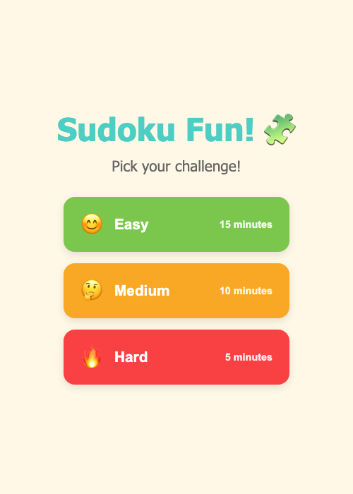
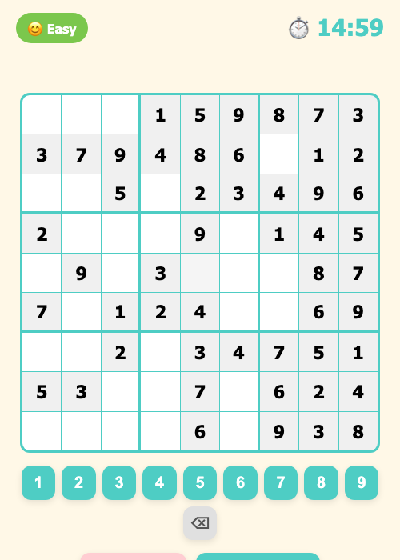

# Sudoku

A fully native Android Sudoku game, built with Kotlin and Jetpack Compose (Material 3).

Originally a Capacitor/web hybrid, now rewritten as a 100% native Android app — no WebView, no cross-platform runtime.

## Screenshots

<p align="center">
  
  
</p>

## Features

- **Three difficulty levels** — Easy (15 min), Medium (10 min), Hard (5 min)
- **Countdown timer** with an urgency pulse under 30 seconds
- **Real-time validation** — highlights rule violations as you play
- **Haptic feedback** on cell selection, number entry, errors, and wins
- **Solution reveal** — color-coded answers (givens, your correct entries, auto-filled)
- **Win celebration** — animated board on completion

## Tech Stack

- **Kotlin** + **Jetpack Compose** (Material 3)
- **AndroidX Lifecycle ViewModel** for unidirectional state
- **Gradle** with Kotlin DSL + version catalog (`gradle/libs.versions.toml`)
- minSdk 24, target/compile SDK 36

## Getting Started

### Prerequisites

- Android Studio (JDK 21 bundled JBR) and the Android SDK (platform 36)
- An Android device or emulator

### Build & Run

```bash
export JAVA_HOME="/Applications/Android Studio.app/Contents/jbr/Contents/Home"
./gradlew :app:installDebug    # build + install on a connected device/emulator
```

Or open the project root in Android Studio and press Run. The debug APK is written to
`app/build/outputs/apk/debug/app-debug.apk`.

## Project Structure

```
app/src/main/java/com/alfredang/sudoku/
  SudokuEngine.kt      # Pure game logic: generation, validation, win check
  GameViewModel.kt     # State management, timer, haptic events
  MainActivity.kt      # Compose entry point
  ui/SudokuApp.kt      # All Compose UI (menu, board, number pad)
  ui/theme/Theme.kt    # Material 3 theme + brand colors
app/src/main/res/      # Launcher icons, theme, strings
```

See [CLAUDE.md](CLAUDE.md) for architecture details.

## Related

This project (`com.alfredang.sudoku`) is not published on Google Play. The published Tertiary Infotech Sudoku app is **[Tertiary Sudoku on Google Play](https://play.google.com/store/apps/details?id=sg.com.tertiarycourses.sudoku)** ([source](https://github.com/alfredang/sudokuapp-android)).

## License

ISC
